+++
date = '2026-10-04T17:37:23-07:00'
title = '2026 Q4 Timecards'
+++

---

## Sunday 2026/10/25

* 2 hours today, 694.5 hours this track year.

Taking Strawn's entrance gate shift.

#### 7:00AM - 9:00AM (2 hours)

Strawn was not feeling well so I took over his morning shift at the entrance
gate. Getting up early to arrive by 7AM is not something I would have done
by choice! It was also very cold at the booth so I was very eager to go get
hot food and coffee when the shift was over.

---

## Friday 2026/10/23

* 7 hours today, 692.5 hours this track year.

Frantic signals repairs before bulk of Fall Meet guests arrive.

#### 8:00AM - 12:30PM (4.5 hours)

Threat of rain (and a bit of actual rain) kept majority of our Fall Meet guests
away and that is good news for signals: we have some elbow room to make fixes
before everyone shows up.

Also good news: signal head HC started indicating correctly. We'll keep an eye
on it over the weekend and be ready to jump on it as needed.

IC didn't start working better, though, and this is a signal whose malfunction
could lead to head-on collisions so this was definitely the red alert work item
of the day. It wasn't just the micro switch that was bad, some of the wiring
and crimp connectors had to be redone as well for reliable operation.

Also very important was the Minden siding switch HS1, because that is around a
blind corner and steam locomotives do use that location to top off water. We
need the preceding signal HFA/B to warn incoming locomotives with red/yellow
if that switch was thrown.

A quick verification lap confirmed everything looked good beyond panel M. Time
to get some food in the belly then let's jump on that.

#### 1:30PM - 4:00PM (2.5 hours)

Spent the afternoon struggling to understand why panel M block detectors show
fault even though all the track voltages are within proper range. Eventually
pinned blame on an unexpected path for current to flow, aided by the damp soil
after rain. But exactly what power, and going where, remains mysterious.

Like I told people later: we never did figure out what it IS, but we did find
many things it was NOT. And that's still progress.

---

## Thursday 2026/10/22

* 6.5 hours today, 685.5 hours this track year.

Signal head cleaning service + situation survey.

#### 12:30PM - 7:00PM (6.5 hours)

I arrived just after a rainstorm to see what has gone haywire. There were many
small issues but I found two big ones: signal heads HC and IC were not
indicating correctly and these are important switches we need to work for the
upcoming Fall Meet. I had a shop vac and compressed air with me so it was
pretty quick to give those position sensors a quick clenaing. Better, but not
quite good enough. This will need more work.

I had the vacuum and the air compressor because another goal of today's visit
was a cosmetic appearance cleaning pass. First the shop vac for big clumps of
dirt tangled in spider webs, then a damp towel to wipe off bird poop and any
remaining residue, and a stream of compressed air to clean out details.

---

## Sunday 2026/10/18

* 9 hours today, 679 hours this track year.

Disney Sunday

#### 8:00AM - 5:00PM (9 hours)

Started the morning by pulling CN2002 out of the barn for a little bit of
exercise, starting with a trip down to Valley Division to replace a screw on
signal head SA. When replacing it with a side marker LED faceplate, I managed
to lose a faceplate screw. (It was in my small magnetic parts tray and I
unintentionally bumped it on its lip turning it into a catapult.)

No running public with CN2002 today as there were enough trains. We had SF163,
UP1989, SPSF, and Fuad's engine all pulling bench car sets. I also lacked the
Ryobi battery necessary to run the air compressor for air brakes. Which meant
CN2002 will be on show-and-display. To put on a good show and display, I pulled
out my pile of microfiber towels and used the Alexander-designated paint care
product to shine things up.

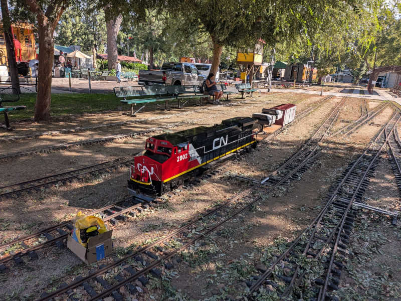

Since I had my train cosmetic care kit out, I put away Alexander's CN2002
product and switched over to my own bottles to give SF163 its own glow-up
treatment.

I was the east gate person for about two hours in the afternoon, where I had
the chance to chat with other lovely Carolwood staff at the booth in between
making sure the track is cleared when a train comes through.

Plus random other miscellaneous tasks as part of being the Sunday crew. I was
busy enough I didn't have time to bring out Chessie or Sankey for display.
Silver brought out his Nickel Plate Road locomotive which tempted Murphy to
bring out his NS Dash-9 set but he did not. The biggest novelty show train is
Horgan's steam locomotive pulling his sete of passenger cars. Choo-choo is
always a crowd pleaser.

---

## Saturday 2026/10/17

* 10 hours today, 670 hours this track year.

Signals work day.

#### 8:00AM - 12:30PM (4.5 hours)

Started the day with the most important mainline impact: ESM2 position sensing
switch, which has been working intermittent for several weeks, got replaced.
This should resolve the misleadingly reported "can't select track 1" issue.

After that was done, we went back to paying panel P the attention it has long
been deprived of. Most important for a sense of completeness, Strawn and Harper
found the failed power wire for that seventh dwarf and ran a replacement so it
illuminates along with the rest. Working in parallel, Katz and I installed a
set of side marker LED modules to the maintenance bay dwarf using my 3D-printed
TPU ring. The inner diameter proved to be a tad too large, allowing the LED
modules to pop out. Putting a loop of electrical tape will allow this initial
field test to proceed. Next round will have TPU rings with a smaller inner
diameter.

#### 1:30PM - 7:00PM (5.5 hours)

Once all seven lights were illuminating, we turned our attention back to P NT.
The ancient NT board did not allow adjustment of timeout, so it was swapped out
with a newer board that did. Then, to trigger that timer, we connected the
mainteance bay button as well as the currently working NT track block located
on south track east of the driveway. Finally, the previously-nonworking NT
track block located on the north track west of the driveway got a look see. I
found two breaks in underground wiring that had allowed water to seep in and
corrode the wire to nothing. Cutting them out and splicing the remaining wires
together brought the NT block back.

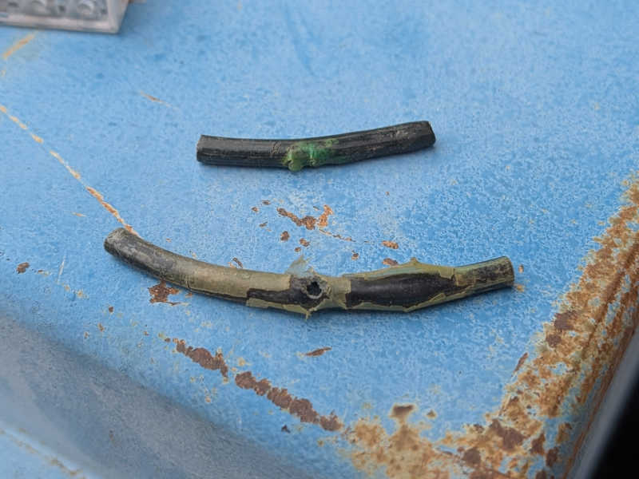

Now trains exiting Phil West yard westbound will be sure to trigger the NT ring.

---

## Friday 2026/10/16

* 2 hours today, 660 hours this track year.

Dwarf signal remains stubborn.

#### 12:30PM - 2:30PM (2 hours)

I stopped in for a quick work session, hoping to bring that final seventh
yard dwarf back online. Replacing bulbs and a socket allowed me to get the
dwarf running on battery power, but it still needs a power feed to actually be
useful.

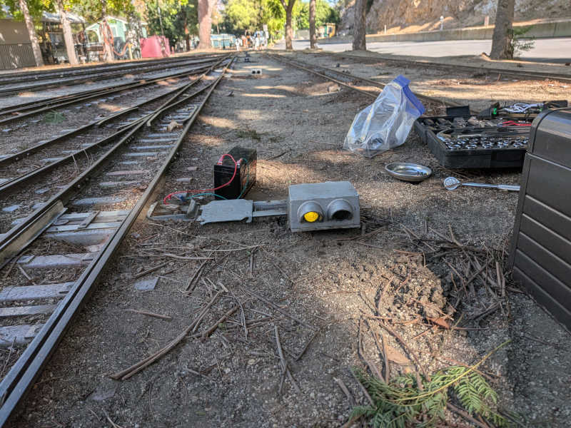

---

## Tuesday 2026/10/13

* 10 hours today, 658 hours this track year.

Signals work day.

#### 8:00AM - 12:00PM (4 hours)

Following up yard/Sutchville yard dwarf work, today we brought the associated
motor back online so now it is a motorized switch again. This is expected to be
useful at the upcoming Fall Meet. Remaining yard switches remain manually
operated and no visual indication beyond watching the points. We won't have
time to do anything about that for this Fall Meet. Maybe the next one?

After that was up and running we revisited the crossover switch with my very
temporary zip-ties. Repositioning the microswitch (required drilling several
new holes) brought it back to operating condition without any zip ties at all.

Panel S main control ESP32 was upgraded so it can participate in cross-panel
communications. This required some rewiring work because the new code moved
some wires around for no functional need.

#### 1:00PM - 7:00PM (6 hours)

Panel P has no contact with public route and thus has rarely been considered a
high priority. Today we pay attention! First job is to get it to rejoin the
timer ring. We had to patch a broken connection inside a vault but first we
had to find the buried vault!

Cleaning up the buried vault also allowed us to find wires associated with NT
block that had stopped working. More answers would have to wait for another
work day.

After Strawn departed, Harper and I focused on the Phil West yard ladder
track dwarf signals, the "Seven Dwarves". Many had burnt out light bulbs,
several had damaged microswitches that had to be replaced, and three had bad
power wires. We were able to fix two of the bad power wires, but one dwarf
is still broken. Getting six out of seven dwarves back online is a great start.

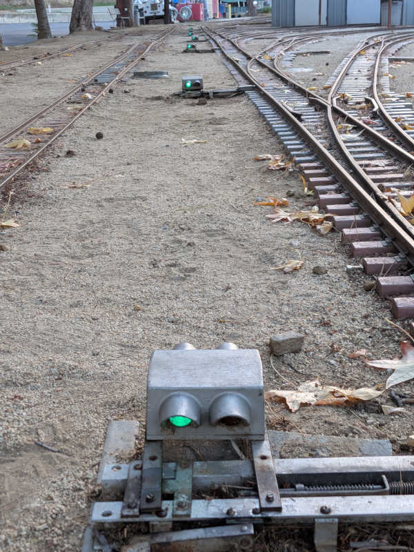

But that last one taunts me. I took out my frustrations by shoveling some dirt.

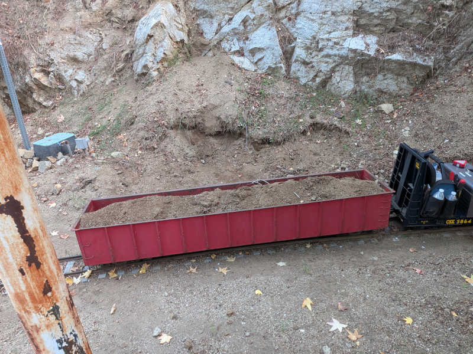

---

## Sunday 2026/10/11

* 2 hours today, 648 hours this track year.

Fire extinguisher check, squirrel war continues.

#### 5:00PM - 7:00PM (2 hours)

Public run cancelled so I went to check out the Galpin auto show instead.
Stopped by the club on the way home and performed my monthly fire extinguisher
check. After that, loaded up a gondola with Crystal Springs Drive dirt and
filled some squirrel holes alongside minor signals work.

---

## Saturday 2026/10/10

* 7 hours today, 646 hours this track year.

Signals work day.

#### 8:00AM - 12:00PM (4 hours)

Started by wrapping up a loose end from last time: the yard/Sutchville dwarf
now has a proper dwarf faceplate instead of a full size faceplate with the
bottom chopped by a band saw.

Then we moved to BSM5 which had lost all power, and traced the problem to
wires disintegrated inside a wire nut. Trimming wire to expose fresh conductor
brought the motor back.

While testing that fixed motor we noticed BH showing the intermittent false
red that has been haunting us for a while. This opportunity allowed us to go
chase down the bad bond wire and get it fixed hopefully once and for all.

Onward to panel S where we diagnosed the cross-panel communication issues
and decided S and R need to send reference ground from each other as the design
originally specified and not try to do anything fancy with shared grounds.
That's just not going to fly in the new world of regulated power supplies.

#### 1:00PM - 4:00PM (3 hours)

Panel S received the next iteration of block detector and signal driver boards,
now each with their own ESP32 brain and communicate with the main ESP32 via
serial link. This cuts down on the wiring within the panel and I hope it will
pan out as hoped.

Griped about enclosure for RSM2 and how it defeated several of the points of
putting position sensing microswitch inside an enclosure. Why go through all
this effort just to expose it to the environment?

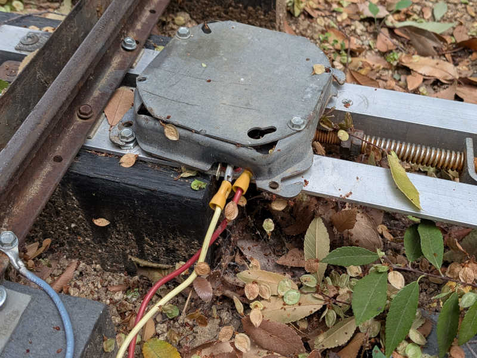

After Strawn departed I continued working on issues I found. False red on
KD and KEA traced to a bad bond wire that was replaced. Also found a bad
crossover signal head that was not indicating rail switch position reliably.
I could make it a bit better with zip-ties but that's still not a proper fix.

---

## Thursday 2026/10/8

* 9.5 hours today, 639 hours this track year.

Signals work day.

#### 8:00AM - 1:30PM (5.5 hours)

Started the day reviving the dwarf signal indicating yard vs. Sutchville.
How old was the old equipment? We found LEDs instead of incadescent bulbs so
they're not that old... but the LEDs were mounted in wood. Who needs circuit
boards when you have wood?

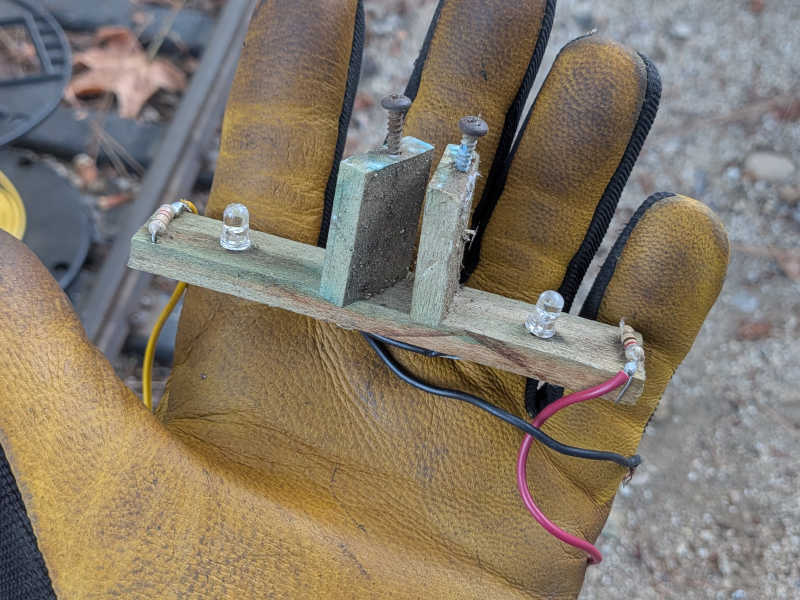

I didn't have a dwarf faceplate ready but I did have a B signal head with the
big side plates. In order to make things fit I trimmed the bottom part short
with a band saw so that plate will fit in a dwarf position allowing us to
deploy commodity side marker LED modules on this dwarf.

Once that was done we split up. I went up to fix the switch motor controlling
mainline/Akins while the rest worked on panel S NT. Fortunately my part only
needed a little cleaning then I started working on putting a switchmode power
supply in panel S. This took most of the day to figure out.

#### 2:30PM - 6:30PM (4 hours)

After lunch break I had fuel for my brain to wrap up the power supply upgrade.
While I was doing this Strawn went over to panel J to play with the NT block
and we found out the current generation switch motor boards can completely
freak out flipping the motor back and forth in the presence of power issues we
are still struggling to understand. We suspect this episode was triggered by
a regulated power supply interacts with a linear power supply via NT ring.
No good! And this means until we understand what's going on, we shouldn't
bring panel S NT block back online either. Sucks.

After I verified basic panel S functionality after the power supply upgrade,
I pulled out the old giant transformer. Since it was held with nuts on the rear
panel this meant dropping the entier panel to access those nuts. Not pleasant
but not as bad as I thought it might have been.

The problems didn't come up until I looked at cross-panel communication. The
ground reference has changed with the switchmode power supply so I disconnected
wires to panel R until we can understand what's going on.

The day ended with a bit of humor mirroring the morning's wood circuit board:
some old signals components were found buried in the dirt adjacent to the
siding resurrection project.

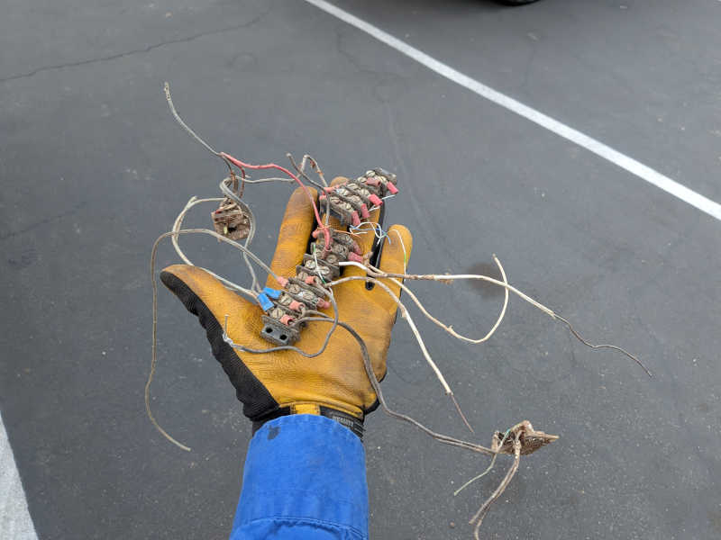

We're not going to be able to use... whatever this was.

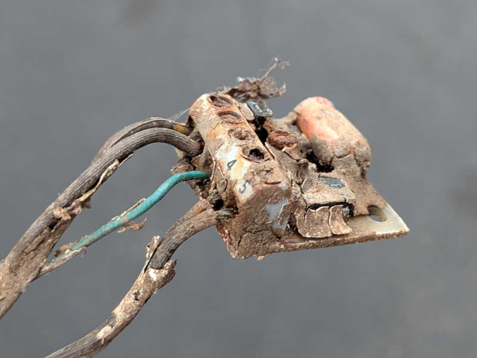

---

## Monday 2026/10/5

* 3 hours today, 629.5 hours this track year.

SF163 maintenance.

#### 3:30PM - 6:30PM (3 hours)

Arrived in the afternoon to go through my normal routine before the monthly
board meeting: make sure SF163 is in tip top shape. The primary task was to
make sure the battery water is topped up. There was a broken chain on the
riding car lid that I had to repair by removing the broken link and hook up
the next link down.

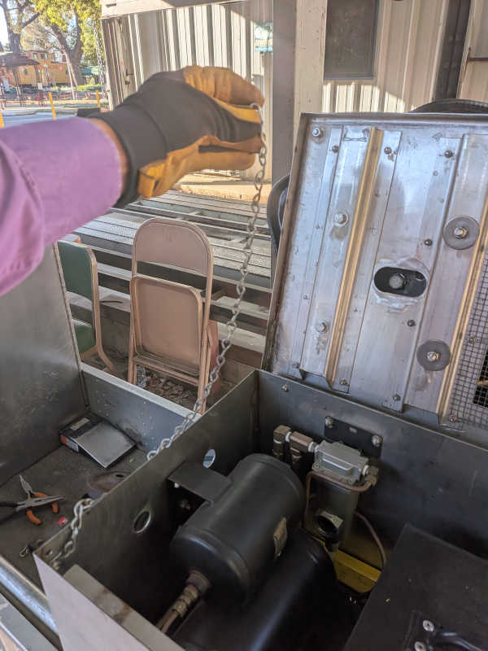

The positive (front) terminal on the rearmost battery is concerning. I thought
I cleaned off all the seeped-out acid but the terminal has continued to
corrode. I need to dig up my battery acid neutralizer spray and hit it next
month.

There's been conversation of having replacement gearmotors on stock at the club
for their eventual replacement. I asked how they've been failing in the past
and learned it was because the lubricant leaked out. Curiously, the gearbox has
neither an oil drain plug or an oil fill plug, meaning there's not really
anything we can do make sure the gearbox doesn't dry out. This seems like a
less than optimal design!

I looked from underneath the locomotive with an eye on lubrication. I can see a
thin ring of shiny liquid at the gearbox seal and the axle shaft is dirty from
dust sticking to a thin film of oil. This was visible to varying degree on the
first, second, and fourth axles.

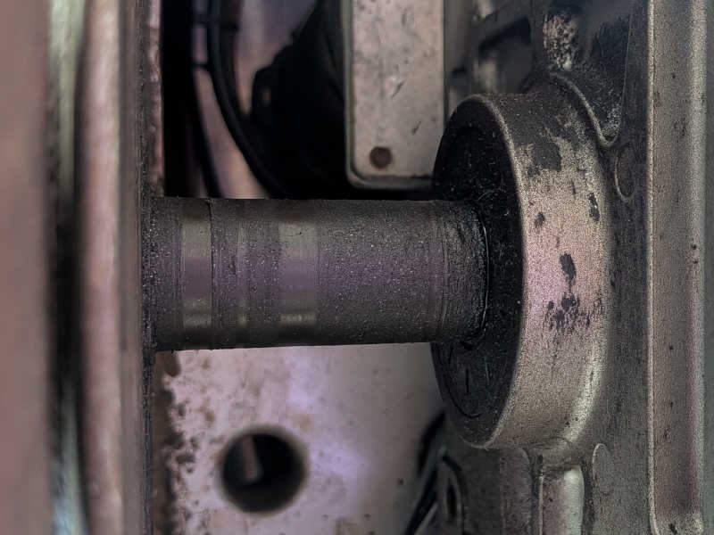

The third axle looks dry and there's no gunk accumulation.

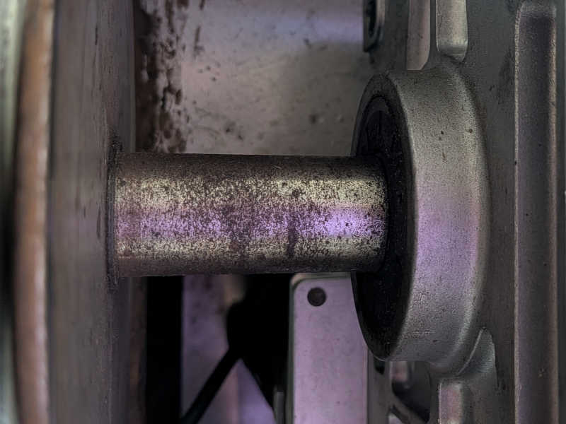

Without an oil level check or a fill plug, there's nothing I can do for
the other three axles. I don't particulary enjoy that feeling, but oh well.

To make myself feel better, I pulled out the cosmetic maintenance kit and made
SF163 look pretty. I am not happy someone put her away with a big glop of bird
poop on the roof. It's gone now.

---

## Saturday 2026/10/3

* 4 hours today, 626.5 hours this track year.

#### 8:00AM - 12:00AM (4 hours)

Joined meeting at panel A with Strawn and Brock on what we would like panel A
to become in the future. I'm usually more focused on immediate problems and
this was a change of pace. I found myself feeling impatient with discussions
about far off dreams when we have mainline problems to fix. It didn't help that
the long term problems I personally want to fix (switch NT ring to wireless)
was shot down. On the upside, I asked why the layout is so focused on toggle
buttons to switch between state instead of buttons that let the user command a
desired state and there didn't seem to be any reason why not. Might be worth
chasing down in the near future to solve some immediate problems.

#### Signals electronics work afternoon (0 hours)

After lunch we continued working on next iteration of signals electronics in
Strawn's air conditioned home instead of heat wave outdoors. We switched in and
out of signals too often for me to know how many work hours I should claim so
I'm not going to claim any for this session.
